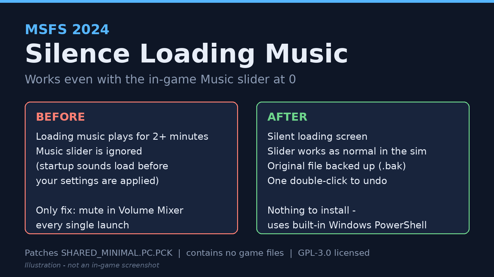
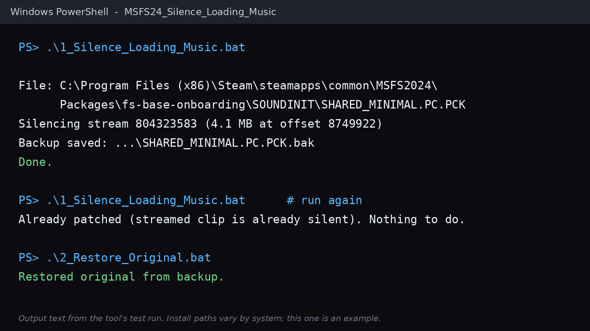

# MSFS 2024 - Silence Loading Music

Silences the loading-screen music in Microsoft Flight Simulator 2024 **even when the in-game Music slider is set to 0**. Nothing to install: it uses PowerShell, which is built into Windows.



## Why the slider doesn't work

The loading music is part of the startup sound package, which the sim loads *before* your settings are applied:

```
Packages\fs-base-onboarding\SOUNDINIT\SHARED_MINIMAL.PC.PCK
```

That file is a Wwise `AKPK` container holding four sound banks and one streamed music clip (~2 minutes, looping). This tool replaces that clip with silence of exactly the same byte size, so the container layout is untouched. The in-game music (`MUSIC.PC.PCK`) is not modified, so the slider keeps working normally once you're in the sim.

**This repo contains no game files.** The script edits *your own* copy and keeps a backup next to it (`SHARED_MINIMAL.PC.PCK.bak`).

## Usage

1. Close MSFS 2024.
2. Download this repo (or the zip from Releases) and unzip it.
3. Double-click **`1_Silence_Loading_Music.bat`**.
4. Launch the sim.

### Finding your install (automatic)

The tool finds your MSFS 2024 install by itself, wherever it lives:

- **Steam:** reads Steam's registry entry and every Steam library (`libraryfolders.vdf`), then looks for the MSFS 2024 app manifest (app id `2537590`). Works on any drive or library folder.
- **Microsoft Store / Xbox app:** looks up the `Microsoft.Limitless` package and each drive's `.GamingRoot` file, which points at the real `XboxGames` folder, wherever it is.
- **Fallback:** if neither works, it scans the usual install folders on every drive.

If you have both a Steam and a Store install, it patches both. Everything it checks is printed, so if it can't find your install you can see why.

Still not found? Pass the full path to the file, using *your* MSFS 2024 folder:

```powershell
.\msfs24_silence_loading_music.ps1 -Path "<your MSFS 2024 folder>\Packages\fs-base-onboarding\SOUNDINIT\SHARED_MINIMAL.PC.PCK"
```

(Steam: `...\steamapps\common\MSFS2024`. Store / Xbox app: `...\XboxGames\Microsoft Flight Simulator 2024\Content`.)

Other options: `-DryRun` (show what it would do), `-Restore` (put the original back; same as `2_Restore_Original.bat`).



## Notes

- **Updates:** Steam updates and "Verify integrity of game files" restore the original file. Just run the tool again. It finds the clip by reading the file's own index, so it isn't tied to a single game version.
- **Safety:** if the file's layout isn't what the tool expects (for example after a big game update), it refuses to modify anything. It is idempotent: running it twice does nothing the second time.
- **Tested** on the Steam version of MSFS 2024. Microsoft Store / Xbox app detection is new in v1.1.0 and hasn't been confirmed on a real Store install yet. If you use that version, please [tell me how it went](https://github.com/ItzSteveHuh/MSFS24_Silence_Loading_Music/issues).
- **Undo:** run `2_Restore_Original.bat`, or use Steam > Properties > Installed Files > Verify integrity of game files.
- The script is plain text: open `msfs24_silence_loading_music.ps1` in Notepad to read exactly what it does.

## How it works (technical)

0. Locate the file (see *Finding your install* above).
1. Parse the `AKPK` header: soundbank table and streamed-file table (each entry is `id, block size, size, start block, language`).
2. For each streamed file over 1 MB that is a RIFF `fmt` tag `0xFFFF` (Wwise Vorbis), build a silent stereo 48 kHz 16-bit PCM `RIFF/WAVE` of exactly the same size (extensible `fmt`, zeroed `data`, small `JUNK` chunk as padding).
3. Write it over the original bytes in place, then re-read and verify.

## Changelog

- **v1.1.0:** automatic install detection for Steam (registry, all libraries, app manifest) and Microsoft Store / Xbox (`.GamingRoot`), handles several installs at once, prints what it checked, clearer error messages.
- **v1.0.0:** first release.

## Verify the download

The release zip was scanned on VirusTotal: [scan results](https://www.virustotal.com/gui/file/9dcba435e32a4a3fb2793bebb8b700111718cdc2566c354aa128a7676e128100)

SHA-256 of `MSFS24_Silence_Loading_Music_v1.1.0.zip`:
`9dcba435e32a4a3fb2793bebb8b700111718cdc2566c354aa128a7676e128100`

Check yours with `Get-FileHash .\MSFS24_Silence_Loading_Music_v1.1.0.zip` in PowerShell. Or skip the zip and read the source here.

## Support

Found a bug or have a question? [Open an issue](https://github.com/ItzSteveHuh/MSFS24_Silence_Loading_Music/issues). Please include whether you're on Steam or Microsoft Store, your MSFS 2024 version, and the text the tool printed when you ran it.

## Disclaimer

Use at your own risk. Not affiliated with or endorsed by Asobo Studio, Xbox Game Studios or Microsoft. "Microsoft Flight Simulator" is a trademark of Microsoft.

## License

Copyright (C) 2026 ItzSteveHuh. Licensed under the [GNU General Public License v3.0](LICENSE) (or, at your option, any later version).

You're free to read, run, modify and share this code. If you distribute it or a modified version, it must stay under the same license, the full source must be available, your copy must keep the original copyright notices, and you must clearly mark what you changed.
